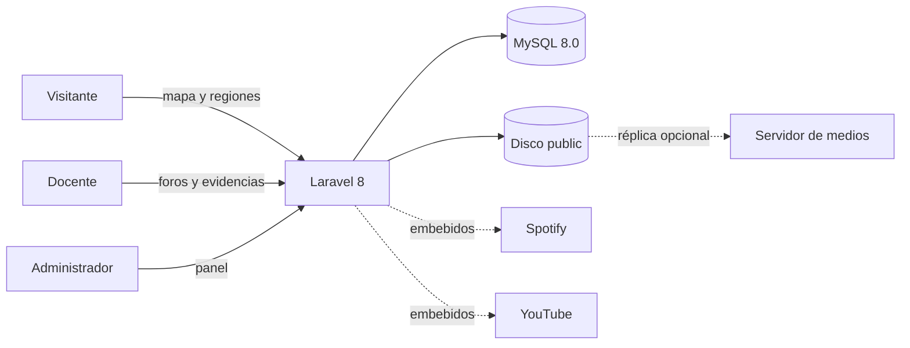

# Plataforma de lectura multimedia de literatura regional colombiana (Laravel)

[](https://github.com/KevinAndrey96/laravel-edtech-reading-experience-platform/actions/workflows/ci.yml)


Plataforma EdTech de la iniciativa **Crazy Books** para acercar a docentes y estudiantes a la literatura de las regiones culturales de Colombia. Un mapa interactivo lleva a cada región y cada libro se abre como una experiencia multimedia: podcast en Spotify, videos en YouTube, imágenes y mensajes pedagógicos para el docente. Los docentes comparten reflexiones en un foro por libro y registran las evidencias de lectura de sus estudiantes.

## Funcionalidades

- **Mapa interactivo de regiones** (Alto Magdalena, Amazonía, Caribe, Cundiboyacense, Insular, Noroccidental, Orinoquía, Pacífica, Santanderes y Suroccidental), público y sin inicio de sesión.
- **Libros multimedia por región:** portada, podcast, audio, videos, imágenes y textos guía para el aula.
- **Foro pedagógico por libro:** cada docente publica, edita y elimina sus propias reflexiones.
- **Evidencias de lectura:** el docente registra estudiante, curso y un archivo (imagen, audio, video o PDF) asociado al libro.
- **Panel de administración:** usuarios, regiones, libros y consulta de evidencias por libro o región.

## Roles y permisos

| Rol | Puede |
| :--- | :--- |
| Administrador | Gestionar usuarios, regiones, libros y todas las evidencias; registrar evidencias a nombre de un docente. |
| Docente | Ver regiones y libros, participar en los foros y registrar sus propias evidencias. |

No hay registro público: las cuentas las crea un administrador. El permiso de administración es un Gate (`can:admin`) aplicado a las rutas del panel, y las acciones sobre experiencias verifican que el usuario sea el autor.

## Arquitectura



```text
app/
├── Http/Controllers/   Region, Book, Experience, Evidence, User y Home
├── Models/             Region, Book, Experience, Evidence y User
├── Providers/          Gate "admin"
└── Services/           MediaUploadService: guarda en el disco public y replica si hay servidor remoto
database/
├── migrations/         Esquema evolutivo de Laravel
├── schema.sql          Esquema completo para levantar MySQL con Docker
└── seeds.sql           10 regiones, 30 libros, usuarios y datos de demostración
```

Las subidas solo aceptan imágenes, audio, video o PDF hasta 10 MB, y la extensión del archivo guardado se toma del contenido real, no del nombre que envía el navegador. La réplica a un servidor de medios se activa con `UPLOAD_REMOTE_URL`.

## Puesta en marcha con Docker

```bash
cp .env.example .env
make up          # app PHP 8.1, Nginx, MySQL 8.0 (con schema.sql y seeds.sql), Redis y Mailpit
make install     # dependencias de Composer dentro del contenedor
make key
```

- Aplicación: http://localhost:8000
- Mailpit: http://localhost:8025

`make help` lista el resto de comandos (`logs`, `sh`, `reset-db`, `seed`, `lint`, `test`).

### Usuarios de demostración

Todos con la contraseña `password`, solo para el entorno local:

| Rol | Correo |
| :--- | :--- |
| Administrador | `admin@example.com` |
| Docente | `elena.restrepo@docentes.example.com` |
| Docente | `carlos.benitez@docentes.example.com` |

## Calidad

```bash
composer lint    # Laravel Pint
composer test    # PHPUnit con SQLite en memoria
```

Las pruebas cubren las páginas públicas, el registro deshabilitado, los permisos por rol en cada página del panel, los foros, la propiedad de las experiencias y la subida de evidencias (tipos permitidos, archivos ejecutables rechazados y atribución del docente). El CI corre Pint y PHPUnit en PHP 8.1 y 8.2, carga `schema.sql` y `seeds.sql` en MySQL 8.0, ejecuta las migraciones sobre una base vacía y construye la imagen Docker.

## Historia

Proyecto de 2023 desarrollado con Jhonathan Perea para la iniciativa Crazy Books. En noviembre de 2026 se ordenó sin cambiar el stack:

- permisos por rol y registro público cerrado;
- validación estricta de subidas;
- la página de región, el foro y la edición de experiencias, que estaban rotos, volvieron a funcionar;
- migraciones corregidas para que coincidan con el esquema;
- controladores duplicados y vistas sin uso eliminados;
- Pint, pruebas y CI.

El historial se limpió de archivos subidos por usuarios.

## Licencia

Sin licencia de código abierto. El proyecto nació como trabajo para un cliente y se publica como muestra de portafolio: todos los derechos reservados.
