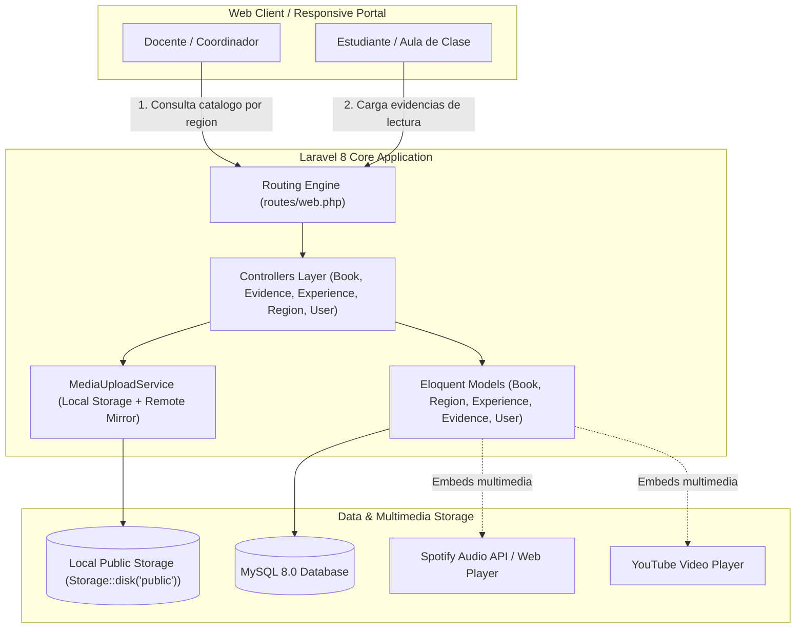
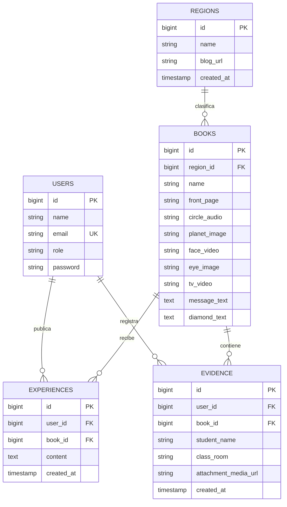

# EdTech Reading Experience Platform

[](https://github.com/KevinAndrey96/edtech-reading-experience-platform/actions/workflows/ci.yml)
[](https://www.php.net/)
[](https://laravel.com/)
[](https://www.mysql.com/)
[](https://www.docker.com/)
[](LICENSE)

An educational technology (EdTech) platform engineered to foster regional literature, cultural identity, and multimedia reading experiences across Colombia's educational institutions. Originally created under the **Crazy Books** initiative, the platform bridges classroom literacy with regional oral traditions by pairing curated children's literature with Spotify audio podcasts, YouTube author interviews, teacher pedagogical guides, and digital student learning evidences.

Built with Laravel, MySQL, Docker Compose, and a decoupled media asset storage architecture.

---

## Pedagogical & Technical Capabilities

### 1. Colombian Regional Reading Catalog
The platform structures literature across **10 distinct cultural and geographical regions** of Colombia:
- **Alto Magdalena**: Huila and Tolima (folklore, bambuco, oral memory, indigenous heritage).
- **Caribe**: Atlantico, Bolivar, Cesar, Cordoba, La Guajira, Magdalena, Sucre (coastal myths, gaita, cumbia, Afro-Colombian and indigenous Wayuu storytelling).
- **Pacifico**: Choco, Valle del Cauca, Cauca, Narino (marimba rhythms, arrullos, rainforest biodiversity, Afro-descendant community memories).
- **Andina Central**: Cundinamarca and Boyaca (highland poetry, peasant traditions, historical memory).
- **Eje Cafetero y Antioquia**: Caldas, Quindio, Risaralda, Antioquia (coffee landscape narratives, arriero heritage, municipal storytelling).
- **Santanderes**: Santander and Norte de Santander (canyon landscapes, artisan crafts, colonial memory).
- **Orinoquia**: Meta, Arauca, Casanare, Vichada (plains culture, joropo, cattle ranching poetry).
- **Amazonia**: Amazonas, Caqueta, Guainia, Guaviare, Putumayo, Vaupes (ancestral indigenous cosmovision, botanical medicine, sacred nature).
- **Insular**: San Andres, Providencia and Santa Catalina (Raizal culture, Caribbean Creole oral tales).
- **Suroccidental**: Valle, Cauca, Narino, Putumayo (Kamënts̈á and Zio Bain indigenous weaving, Andean-Amazonian transition).

### 2. Multimedia Interactive Layer
Each curated book is equipped with multimodal learning assets:
- **Audio Podcasts**: Integrated Spotify episodes narrating oral traditions and pronunciation.
- **Video Documentaries**: Embedded YouTube educational interviews and author walkthroughs.
- **Pedagogical Guides**: Structured messages and prompts linking reading with local history and social sciences.
- **Visual Assets**: High-resolution covers, visual metaphors, and reading iconographies.

### 3. Teacher Experience Forum & Learning Evidences
- **Pedagogical Reflections**: Teachers document classroom reading methodologies, discussion prompts, and cross-curricular integrations.
- **Student Evidence Repository**: Centralized submission of student reading logs, illustrations, digital recordings, and classroom artifacts with classroom and grade indexing.
- **Access Control & Roles**: Role-based access distinguishing Administrators, Coordinators, Teachers, and Students.

---

## Architecture & Data Flow



---

## Entity-Relationship Architecture



---

## Quickstart & Local Development

### Prerequisites
- Docker Engine 20.10+ and Docker Compose v2+
- Git

### 1. Clone & Setup Environment
```bash
git clone git@github.com-personal:KevinAndrey96/edtech-reading-experience-platform.git
cd edtech-reading-experience-platform
cp .env.example .env
```

### 2. Start Services with Docker Compose
```bash
make up
```

Services exposed:
- **Web Portal (Nginx)**: `http://localhost:8000`
- **Application (PHP 8.1 FPM)**: Internal FastCGI container
- **Database (MySQL 8.0)**: `localhost:3306` (Database: `edtech_reading_platform`)
- **Cache & Sessions (Redis 7.0)**: `localhost:6379`
- **Email Sandbox (Mailpit)**: Web UI at `http://localhost:8025`

### 3. Initialize Database & Seed Catalog
```bash
# Generate application key
make key

# Apply full database DDL schema and load 30 Colombian books across 10 regions
make reset-db
make seed
```

### 4. Convenient Developer Commands
```bash
make help        # Show all available developer commands
make up          # Start all containers in background
make down        # Stop all containers
make restart     # Restart full application stack
make logs        # Tail real-time container logs
make sh          # Open interactive shell in PHP application container
make lint        # Run PHP syntax linting across app, routes and config
make test        # Execute PHPUnit test suite
```

---

## Testing & Quality Assurance

The repository includes an automated GitHub Actions CI pipeline executing on every push and pull request:
- **Multi-Version Matrix**: PHP syntax and linting verification across PHP 8.0, PHP 8.1, and PHP 8.2.
- **Composer Verification**: Autoload and dependency manifest validation (`composer validate --no-check-lock`).
- **Real Database Integration**: Automated MySQL 8.0 service container executing `database/schema.sql` and `database/seeds.sql`, asserting record thresholds for regions (10), books (30), users (6), experiences (6), and learning evidences (6).
- **Docker Compose Specification**: Container configuration and network validation.

---

## Default Access Credentials (Local Environment)

| Rol | Correo Electronico | Contrasena | Descripcion |
|:---|:-------------------|:-----------|:------------|
| **Administrador** | `admin@crazybooks.com.co` | `password` | Gestion integral de usuarios, catalogo y regiones |
| **Docente** | `elena.restrepo@educacion.gov.co` | `password` | Publicacion de experiencias y carga de evidencias |
| **Docente** | `carlos.benitez@educacion.gov.co` | `password` | Moderacion y lectura en la region de Antioquia |
| **Coordinador** | `coordinacion@crazybooks.com.co` | `password` | Supervision pedagogica institucional |

---

## License

This project is open-sourced software licensed under the [MIT License](LICENSE).
